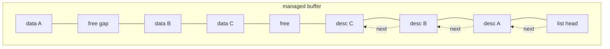
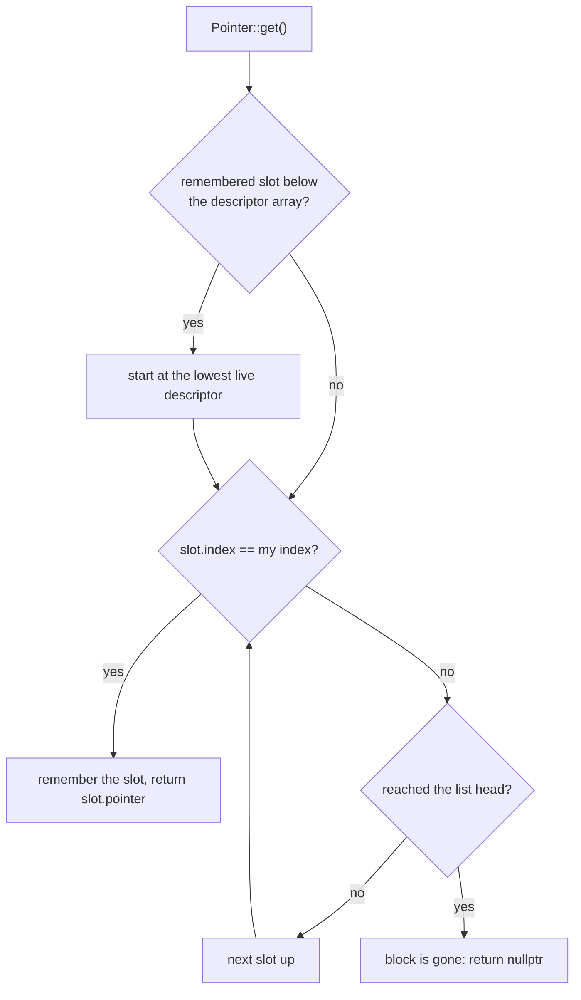

# Allocator + Pointer

[](https://github.com/favorart/allocator/actions/workflows/ci.yml)

A memory allocator over a fixed buffer that can **defragment** itself, plus a
minimal **smart pointer** that keeps working after the allocator moves memory
around. All bookkeeping lives inside the managed buffer: no heap, no side
tables, no extra memory.

Course project, Technosphere (Mail.Ru Group), *Multithreaded programming in C++*, 2015.
Reviewed and fixed in 2026 (see [2026 review](#2026-review)).

## How it works

The arena is used from both ends. User data grows **up** from the start of the
buffer; block descriptors grow **down** from the end. The descriptors form a
doubly linked list sorted by data address, and are stored as a *dense* array:
there are never holes between them.



| Operation | How | Cost |
|---|---|---|
| `alloc(n)` | first fit over the address-sorted list (gaps between blocks, then the tail); the new descriptor takes the next slot below the array | O(blocks) |
| `free(p)` | unlink the descriptor, then move the **lowest** descriptor into the hole to keep the array dense | O(1) |
| `realloc(p, n)` | grow or shrink in place if the space up to the next block allows it, otherwise allocate, copy and free | O(blocks + n) |
| `defrag()` | slide every block down to the end of its predecessor, in address order | O(total bytes) |

### The smart pointer

`Pointer` stores the descriptor address it saw last and the block's unique
**index**. `free()` only ever moves a descriptor *up*, towards the list head,
so `get()` finds a moved block by scanning upward from the remembered slot
until the index matches ("open addressing"):



Indices only grow, so a stale copy of a freed `Pointer` resolves to `nullptr`
instead of to somebody else's block.

## Usage

```cpp
#include "allocator.h"

alignas(std::max_align_t) static char arena[4096];
Allocator a(arena, sizeof(arena));

Pointer p = a.alloc(100);           // throws AllocError(NoMemory) when full
std::strcpy(static_cast<char*>(p.get()), "hello");

Pointer q = a.alloc(100);
a.free(q);
a.defrag();                         // blocks may move...
std::puts(static_cast<char*>(p.get()));  // ...p still finds its data

a.realloc(p, 1000);                 // realloc(p, 0) frees
a.free(p);
```

`main.cpp` is a runnable version of this tour (`make demo`).

## Build and test

Requires a C++17 compiler. Two builds are supported:

```bash
make            # demo + tests, -Wall -Wextra -Wpedantic -Werror
make test       # run the tests
make sanitize   # run the tests under AddressSanitizer + UndefinedBehaviorSanitizer
make demo
```

```bash
cmake -S . -B build -DALLOCATOR_SANITIZE=ON   # the option is for GCC/Clang
cmake --build build
ctest --test-dir build --output-on-failure
```

`./build/allocator_test <substring>` runs only the tests whose names contain
the substring. The suite has no dependencies: the course tests (originally
written for GoogleTest), regression tests for every bug below, and a
randomized stress test that checks every live block byte by byte against a
model after each operation.

CI builds and tests with GCC and Clang on Ubuntu (plain and with ASan + UBSan)
and with MSVC (`/W4 /WX`) on Windows.

## Limitations

- **Not thread-safe.** One allocator, one thread (or an external lock).
- A raw pointer from `get()` is valid only until the next `realloc()` or
  `defrag()`; keep the `Pointer`, not the raw address.
- `get()` costs O(blocks) in the worst case after many frees; it re-caches the
  slot, so repeated calls are O(1).
- Copies of a `Pointer` follow `free()` and `defrag()` moves, but not a
  `realloc()` that moves the block: after it only the `Pointer` passed to
  `realloc()` is valid, the copies resolve to `nullptr`.
- Blocks are raw bytes: no constructors or destructors are run.
- Block indices are 32-bit; after 2³² allocations they wrap around.
- A single request is limited to 2 GiB; every block is rounded up to
  `alignof(std::max_align_t)` (16 bytes with GCC/Clang on x86-64, 8 with MSVC); one descriptor takes 32 bytes
  on 64-bit platforms.
- The `Pointer` must be used with the allocator that created it.

## 2026 review

The original code compiled, but the tests only printed `Error` and `main()` ran
one of them. Running them as real tests under ASan/UBSan found:

| Bug | Effect | Fix |
|---|---|---|
| tail-space check computed `unsigned(negative)` when data met the descriptors | new descriptors written over user data / past the buffer (ASan: global-buffer-overflow) | compare free space without wrap-around |
| a block placed into a gap did not reserve room for its own descriptor | descriptor written over the last block's data | check descriptor room before any placement |
| `alloc()` on an empty allocator skipped the size check | any size "succeeded" | one first-fit path for all cases |
| `free()` lowered the maximal index to the list neighbour's | two live blocks with one index; a `Pointer` resolved to the wrong block | indices only grow |
| `Pointer` scanned from a remembered slot that could already lie in the data area | user bytes read as a descriptor (SEGV) | start the scan no lower than the descriptor array |
| `defrag()` on an empty allocator | null pointer dereference | rewritten loop |
| `defrag()` never moved the first block, `alloc()` ignored the gap before it | lost space at the start of the arena | the list head acts as a block ending at the arena start |
| `realloc()` shrink with an adjacent neighbour | moved the block and copied the old size into the smaller one | in place whenever it fits; copy only when growing |
| descriptors at `base + size - sizeof(Block)`, data at any offset | misaligned access (UB) | aligned descriptor array and data blocks |
| `AllocError` inherited `std::runtime_error` privately | not catchable as `std::exception` | public inheritance |

Plus: member-initialization order, `printf(non-literal)`, string literals as
`char*`, a missing include guard, a Linux/Windows-only `#error`, and a test
that reported success as an error.

## License

[GPL-2.0](LICENSE)
